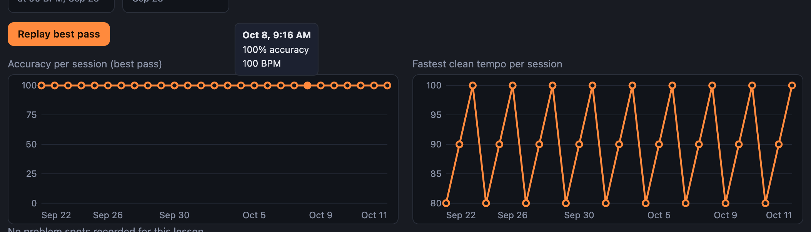
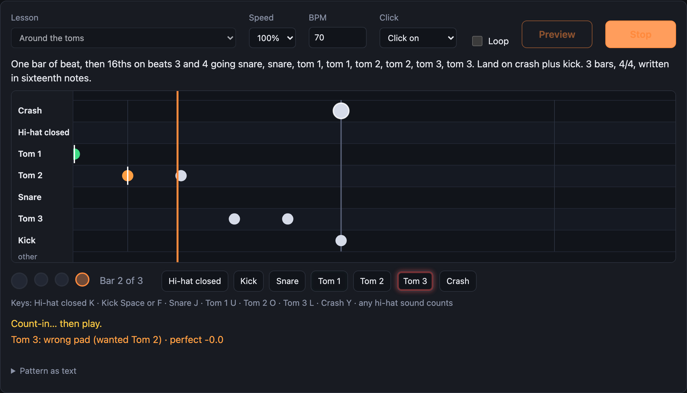
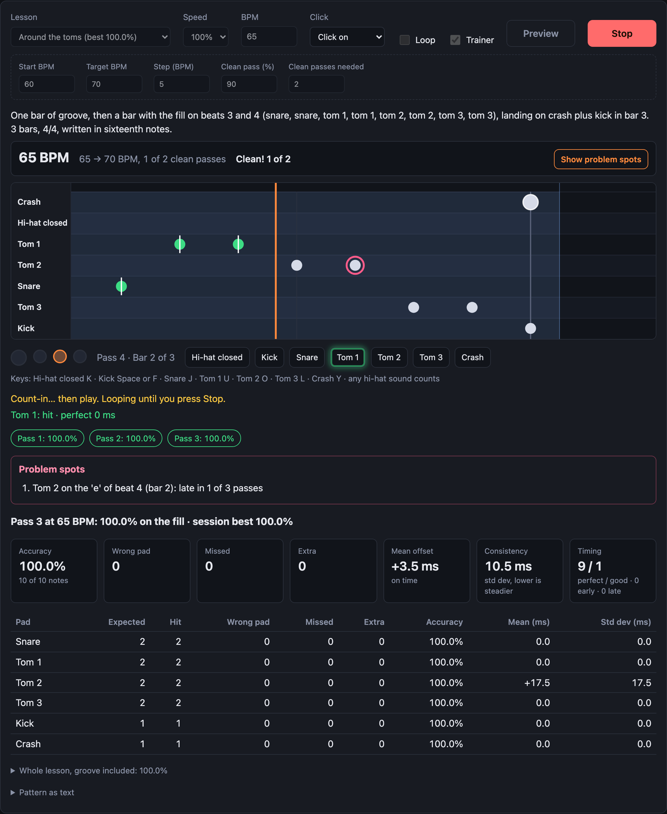
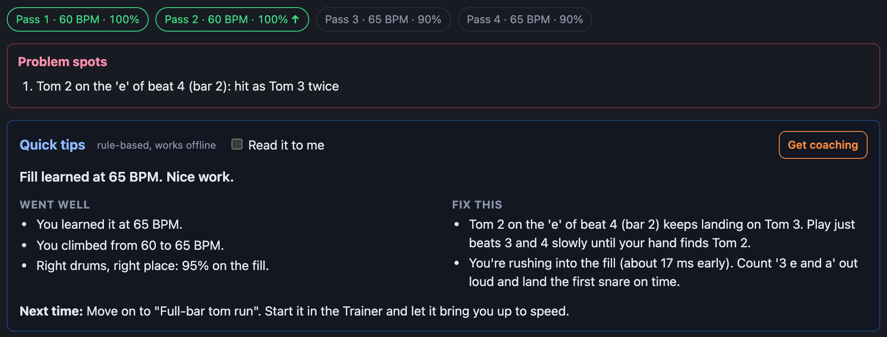

# Drumly

Drumly is a drum practice coach that runs in the browser. It listens to an electronic drum kit over USB MIDI (or your computer keyboard), checks every hit against the beat you're learning, and tells you how many milliseconds early or late you were. It teaches beats, fills and songs at your own pace. A tempo ladder speeds you up only once you play cleanly. After each session a coach points out the notes you keep getting wrong. All timing runs on the Web Audio clock, so a hit 15 ms late is reported as 15 ms late.



| The note highway | Fill trainer | Session coach |
| --- | --- | --- |
|  |  |  |

> **Status:** I built and tested it with the keyboard and scripted hits. The Roland kit it's built for hasn't been plugged in yet. The MIDI pad map, latency calibration and the timing thresholds get tuned on "Kit day", once the kit is back (late October 2026). Until then, treat the exact millisecond thresholds as placeholders.

## Features

- **Play with a kit or a keyboard.** It works with USB MIDI drum kits (Roland V-Drums note map, plus General MIDI), or with the keyboard: F or Space is the kick, J the snare, K the hi-hat, and so on.
- **Every hit graded.** Each note is right pad or wrong pad, hit or missed, and perfect, good, early or late, with the offset in ms. Extra hits are counted too.
- **Note highway.** Notes scroll toward a "now" line in time with the metronome and turn colour as you hit them.
- **Lessons.** Starter rock beats and fills. A fill is played with a groove around it, and only the fill is graded.
- **Fill trainer.** It starts slow and loops. It speeds up after a few clean passes in a row and slows down after rough ones, until you reach the target tempo.
- **Listen, then play.** The app plays the phrase with drum sounds, then you play it back. It alternates until you stop.
- **Compare.** It replays the correct version and then your own hits, one after the other or left and right, so you can hear what you did.
- **Record a fill.** Play something, and it's quantized into a lesson you can practise.
- **Imports.** You can import a MIDI file (pick a range of bars, map unusual notes to pads), or a screenshot of drum notation that Claude reads for you. You check either one before saving. Long songs loop any range of bars.
- **Session coach.** After a run you get problem spots ("snare on 2-and: late in 4 of 5 passes"), what went well, and what to practise next. Claude writes it if you've added an API key. Otherwise built-in rules do, and they work offline. It can read the advice aloud.
- **Progress.** Your practice time this week, a day streak, personal bests per lesson, charts of accuracy and fastest clean tempo, and a replay of any saved best pass. You can export everything to a file and import it into another browser.
- **Settings stick.** Click mode, volumes, sounds, speed, last lesson and trainer settings are remembered between visits.

## How it works

### Input layer (`src/input/`)
Every source (keyboard, Web MIDI, scripted test hits) produces the same `Hit` (`pad`, `velocity`, `time`, `source`) through one `InputManager`. Nothing downstream knows where a hit came from, so grading, the highway and the coach behave the same for keyboard and kit. Hit times come from each event's own `timeStamp`, never from `performance.now()` in the handler. A busy main thread therefore doesn't make hits look late.

### Web Audio metronome: lookahead scheduling and clock alignment (`src/metronome/`)
`setTimeout` can't make sound on time. Drumly uses the lookahead pattern instead:
- A ticker in a Web Worker wakes up every 25 ms.
- Each time, it books clicks for the next 100 ms at exact times on the `AudioContext` clock.
- Click times are computed as `start + n × interval` and never added up step by step, so error doesn't build up over a long song.
- Tempo changes take effect on a beat boundary.

Hits are on the `performance.now()` clock, but clicks are on the audio clock. The metronome maps between the two with `AudioContext.getOutputTimestamp()`. It re-reads that pair every second and exposes every click's time on the `performance.now()` clock, so a hit and the click it belongs to can be compared directly. Grading uses those click times as they are, so the grid you're graded against is the grid you hear.

### The grader: order-preserving alignment, and why greedy failed (`src/grading/match.ts`)
The first version matched greedily: closest note-hit pair first. That breaks for players who are consistently a bit late. Take two hi-hat notes 100 ms apart, played 55 ms late (hits at 55 and 160). Greedy pairs the hit at 55 with the note at 100 because it's closer (45 ms). That leaves the first note "missed" and the second hit "extra", which is the wrong answer. Fast 16ths turned steady late playing into a mess of misses and extras.

The grader now runs an **order-preserving alignment** for each pad (with equivalent pads grouped, like the open and closed hi-hat):
- Matches can't cross: if note A comes before note B, A's hit comes before B's hit.
- It first matches as many notes as possible.
- Among those matchings, it picks the most consistent one: each note's cost is how much its offset changes from the previous note's.

This is a longest-chain dynamic program over the pairs that fall inside the matching window. A second pass then finds wrong-pad hits among whatever is left over.

During play, a `LiveGrader` re-runs the same batch grader on the notes near the current position and updates colours as hits arrive. Summaries never come from those live colours. Each loop pass is graded again as a batch over just that pass, including a little context around its edges so hits near the downbeat land on the right side. A single run is batch-graded from start to finish. The summary, chips, trainer decisions, personal bests and saved history all come from these batch grades.

### The tempo ladder (`src/trainer/`)
- You start at about 60% of the lesson tempo.
- After a set number of clean passes in a row (default: 2 passes at 90% or better), it speeds up by a step.
- Two passes below 70% slow it down.
- When you have clean passes at the target tempo, the fill counts as learned.

Tempo changes are booked for the next pass's downbeat through the metronome's scheduler, so no click moves or plays twice.

### The coach, with a rule-based fallback (`src/coach/`, `server/`)
After a run, a pure function builds a session report with numbers only: accuracy per pass, mean timing and spread, and problem spots (a note that's off in most passes, and what was played instead). There are two ways to turn it into advice:
- **Rules** (`ruleBasedCoaching`): always available, offline, and they never claim anything the numbers don't show.
- **Claude**: if `.env` has an API key, a small route on the local dev server sends the report to Claude and checks the answer's shape. Any error, timeout or odd reply falls back to the rules, and the page says why.

The same server route reads drum notation screenshots for the image import.

## Tech stack

- TypeScript (strict), Vite, Vitest. No UI framework: plain DOM, SVG charts and a canvas highway.
- Web Audio API (metronome and synthesized drum sounds), Web MIDI API, IndexedDB (via `idb`) for history.
- `@tonejs/midi` to read MIDI files, and `@anthropic-ai/sdk` on the dev server only.

## Running it

```bash
npm install
npm run dev        # http://localhost:5173
```

- Use **Chrome or Edge** if you want a MIDI kit. Web MIDI isn't available in Firefox or Safari. The keyboard works everywhere.
- The port is fixed at 5173. Saved history belongs to the exact address, so a different port would look like an empty history.
- `npm test`, `npm run typecheck` and `npm run build` should all pass with no `.env`.

### Optional: Claude features
Copy `.env.example` to `.env` and add an `ANTHROPIC_API_KEY`. That turns on Claude coaching and the notation-image import. `COACH_MODEL` and `IMPORT_MODEL` choose the models. Without a key, coaching uses the built-in rules and the image import is turned off. Everything else works the same.

## Testing

- **446 unit tests** (Vitest) cover the pure logic:
  - MIDI parsing and pad maps; click scheduling and timing math;
  - the grader, including the greedy failure cases and long, sloppy songs;
  - per-pass grading of loops; lessons, the trainer ladder and problem spots;
  - coaching rules and the server routes (with a fake API);
  - MIDI import; history storage, migration, streaks across time zones and daylight saving, bests, backup files, chart geometry and axis labels, and saved settings.
- **Browser checks:** each step was also driven end to end in my own headless Chromium (Playwright, `--mute-audio`). Scripted test hits play real sessions against the real metronome. For this step:
  - each looped pass's summary matches a batch grade of that pass;
  - chart labels are dates or times as appropriate and never overlap, including at phone width;
  - the tooltip works on hover and tap;
  - settings survive a reload, damaged settings fall back to defaults, and the app still works with storage blocked.
- **Not testable yet:** a real kit's MIDI timing, latency, and pad zones. Those wait for Kit day.

## Privacy

- Your practice history, custom lessons and settings stay in your browser (IndexedDB and localStorage). Nothing is uploaded. Export and import are plain JSON files you control.
- The API key stays in `.env` on your own machine. Only the local dev server reads it, and it never reaches the browser or the built bundle.
- Only when you ask for Claude coaching or an image import does the dev server send a session report (numbers, no audio) or the image to the Anthropic API.
